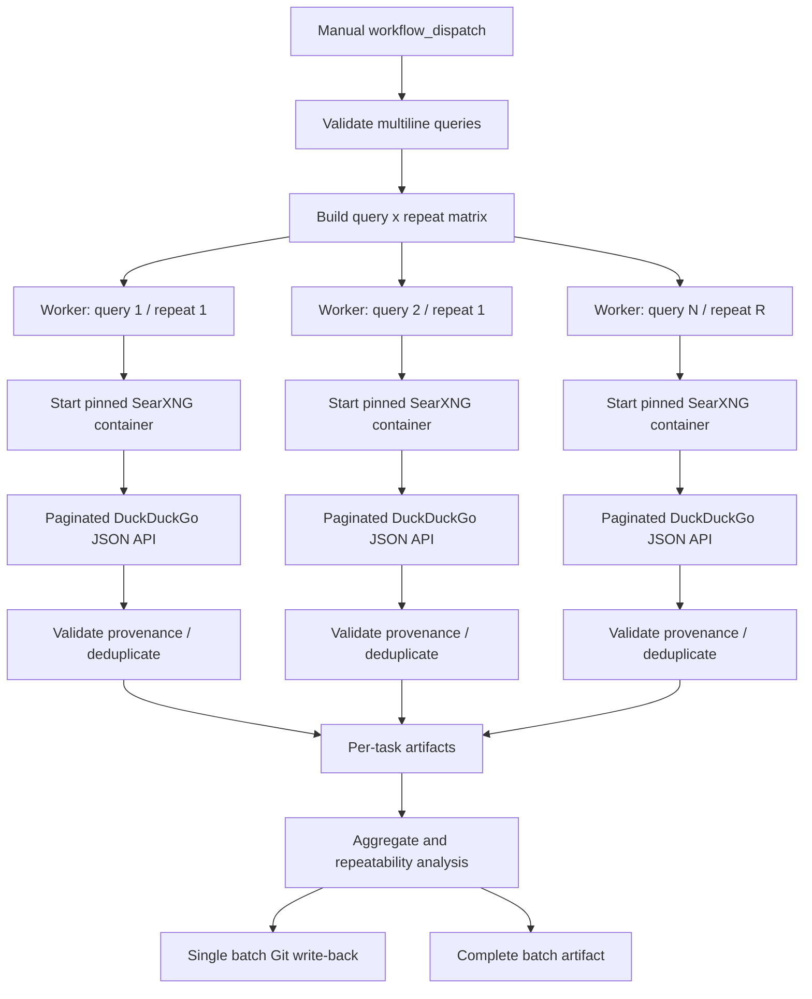

# SearXNG Search Collection Pipeline

A manually triggered, SearXNG-only search collection pipeline for GitHub Actions. The current production path starts a pinned, short-lived SearXNG instance configured to keep **DuckDuckGo as its only upstream engine**, collects paginated JSON results, validates result provenance, deduplicates URLs, and preserves per-query/repeat diagnostics.

The existing DDGS collector and provider experiments are retained as historical/regression material. They are **not used by the production workflow**. The production workflow does not silently switch to Google, Bing, Brave, or another upstream search engine. No API key is required for the tested local SearXNG setup; the upstream DuckDuckGo engine remains subject to its own availability and access controls.

## Current production workflow

Open **Actions → SearXNG Search Collection Pipeline → Run workflow**. It is intentionally `workflow_dispatch` only: no push, pull-request, or scheduled trigger.

### Multi-query input

Enter one query per line. A line may optionally set its own unique-result target using `::` (or a TAB):

```text
machine learning research papers filetype:pdf :: 100
SearXNG pagination reliability :: 50
agentic search systems
```

The third query inherits the configured default `result_limit`. The legacy `search_query` field remains available for older single-query invocations; use either `queries` or `search_query`, not both. Duplicate queries are rejected to avoid accidentally paying for duplicate work.

Each query receives an independent collection job and an independent result target. The workflow expands `query × repeat_count` into a GitHub Actions matrix. `max_parallel_queries` controls the concurrency cap. `fail-fast: false` ensures one failed query does not cancel other queries.

### Workflow controls

| Input | Meaning | Range/default |
|---|---|---|
| `queries` | Multiline query list; optional `:: result_limit` per line | Up to 20 distinct queries |
| `search_query` | Backward-compatible single-query input | Optional |
| `result_limit` | Target for lines without an explicit limit | 10–1000 (preset choices) |
| `region` | Region-to-language mapping | `in-en`, `us-en`, `uk-en`, `wt-wt` |
| `max_pages` | Hard page cap per query and repeat | 5–100; default 20 |
| `repeat_count` | Independent repetitions for stability measurement | 1, 2, 3, or 5 |
| `max_parallel_queries` | Matrix worker concurrency | 1–4; default 3 |
| `page_delay` | Delay between sequential page requests | 1–8 seconds |

A page's returned result count is controlled by the SearXNG/DuckDuckGo engine response, not by a guaranteed page-size setting. `max_pages` is a safety ceiling, not a promise that every page exists or will be served.

## Production architecture

1. **Prepare:** validate and normalize query lines, enforce query/limit/repeat caps, emit a dynamic matrix and immutable batch manifest.
2. **Collect (matrix):** each query/repeat worker installs only the production HTTP dependency, starts its own isolated SearXNG container, and waits for the local service.
3. **Search:** request `/search?format=json` with `pageno`, language and safe-search parameters. The query uses the `!ddg` engine shortcut. The SearXNG settings use `keep_only: [duckduckgo]`.
4. **Validate:** retain only result records explicitly attributed to `duckduckgo`; record all engine counts and unresponsive-engine diagnostics.
5. **Paginate:** stop on target reached, empty page, repeated page, duplicate-only streak, provider error, or page cap. Retry network/429/5xx errors with a bounded retry budget; do not retry HTTP 202/403 or bypass access controls.
6. **Archive:** each matrix worker uploads a query/repeat artifact. One aggregation job combines the artifacts, calculates repeatability, writes the batch archive, and performs a single Git write-back to avoid matrix push races.
7. **Preserve:** upload the complete batch artifact even if one or more collection tasks fail.



## SearXNG runtime and reproducibility

- Image tag: `searxng/searxng:2026.11.1-9ded3bec1`, matching the SearXNG image version observed in the successful 5-page experiment on 2026-11-01.
- Configuration: `config/searxng-settings.yml` keeps only the DuckDuckGo engine and enables JSON output for this local workflow.
- Production runtime dependency: `requests==2.32.4` in `requirements-searxng.txt`. The production workflow does not install DDGS, BeautifulSoup, browser automation, LLM packages, or scraping libraries.
- Docker Hub pull is attempted first; the official GHCR mirror is used if Docker Hub is unavailable.
- The container is short-lived per matrix worker. It is not a public SearXNG deployment.

SearXNG's documented search API supports `/search`, JSON output when enabled in settings, and the `pageno` parameter. Its settings support `use_default_settings.engines.keep_only` for restricting the loaded engine set. See the official [Search API](https://docs.searxng.org/dev/search_api.html), [settings](https://docs.searxng.org/admin/settings/settings), and [Docker installation](https://docs.searxng.org/admin/installation-docker) documentation.

## Output layout

Repository archive:

```text
runs/searxng-batches/YYYY/MM/DD/<run-id>-attempt-<n>/
  batch_metadata.json
  batch_summary.json
  batch_summary.txt
  aggregate_results.csv
  repeatability.csv
  README.md
  queries/
    001-machine-learning-research-papers/
      repeat-01/
        task.json
        raw_results.json
        cleaned_results.json
        cleaned_results.csv
        summary.txt
        collector.log
        run.log
        searxng-container.log
        searxng-container-inspect.json
      repeat-02/
        ...
```

`raw_results.json` preserves page-level raw SearXNG records, engine provenance, HTTP statuses, timings, retries, stop reason and errors. `cleaned_results.json`/CSV contain normalized, unique DuckDuckGo-attributed URLs. `repeatability.csv` contains per-repeat counts and timing. `batch_summary.json` includes min/max/mean counts, exact result-set repeatability and pairwise Jaccard similarity for repeated queries.

## Pagination and repeatability interpretation

A successful HTTP 200 response is not enough: the collector checks that the response is valid JSON, contains a results array, and that individual results identify DuckDuckGo as their source. `SUCCESS` means the requested unique-URL target was reached. `PARTIAL` means some results were retained but the target was not reached. `NO_RESULTS` means no valid results were returned without a page-level request failure. `FAILED` means collection could not produce a successful page or the collector itself failed.

Repeatability is empirical, not guaranteed. Search results can change between runs due to ranking updates, indexing, geography, engine behaviour, or timing. The Jaccard score compares URL sets between repetitions; it is a stability diagnostic, not a relevance metric.

## Existing code retained

- `src/search_collector.py`: prior DDGS hybrid/paginated implementation, retained for historical regression and comparison; not called by the production workflow.
- `scripts/provider_experiment.py` and the four provider experiment workflows: retained unchanged as experiment evidence and diagnostic utilities; they are not the production provider path.
- `scripts/archive_run.sh`: existing fetch/rebase-before-stage write-back logic is reused by the single batch aggregation job.

## Local validation

```bash
python -m pip install -r requirements-dev.txt
bash scripts/validate.sh
```

All provider calls in the unit tests are mocked. They verify configuration, HTTP classification, retries, pagination, repeated pages, duplicate-only pages, engine provenance, result normalization, query parsing, matrix expansion, aggregation, repeatability metrics, workflow triggers, and output persistence. A live GitHub Actions run is still required to validate deeper upstream pagination and repeatability in the runner environment.

## Scope boundary

This release establishes the **search collection layer only**. It does not fetch result webpages, crawl sites, extract PDFs/research papers, summarize pages with LLMs, or build an agent. The data model retains canonical URL, source query, source page and source engine so a later crawler can consume the result archive without coupling crawling to search collection.
