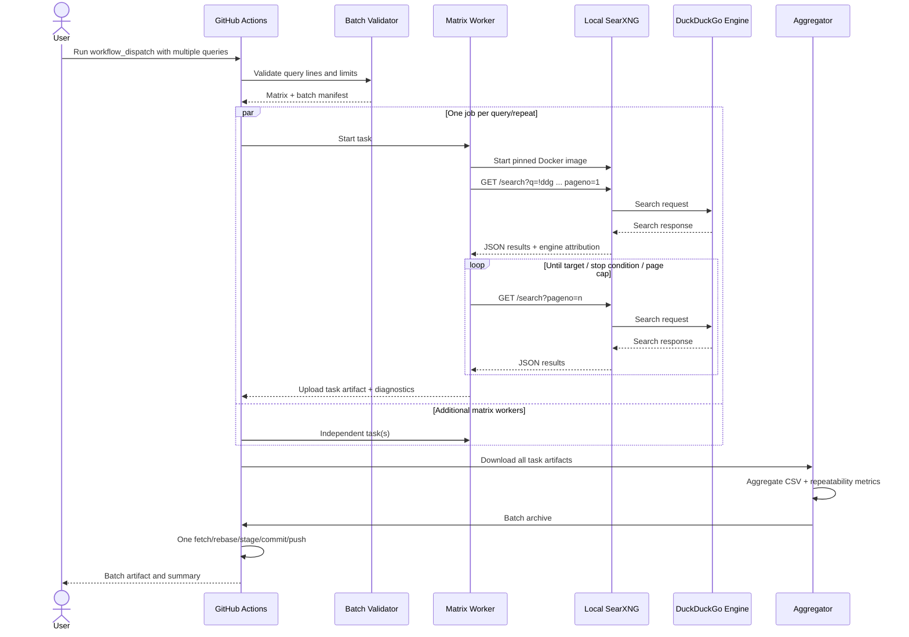
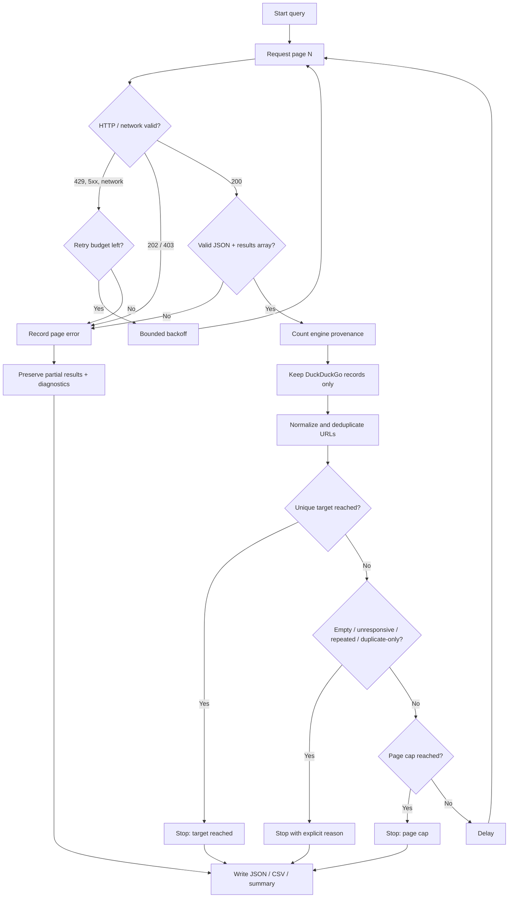

# Production SearXNG Architecture

## Design goals

- Preserve the existing repository and historical DDGS/provider experiment code.
- Use SearXNG as the only provider in the active production collector.
- Restrict the SearXNG instance to DuckDuckGo, and verify result-level engine provenance.
- Support independent result targets for multiple manual queries.
- Support repeat-run validation and deeper pagination with explicit safety caps.
- Preserve partial results, diagnostics, timings and artifacts.
- Perform one repository write-back after matrix aggregation to avoid concurrent commits.
- Keep the search layer independent from future page crawling and content extraction.

## Component boundaries

| Component | Responsibility |
|---|---|
| `src/query_batch.py` | Parse query lines, validate limits, create query/repeat matrix tasks |
| `scripts/prepare_batch.py` | Translate workflow inputs into GitHub Actions matrix and manifest outputs |
| `src/searxng_collector.py` | HTTP client, retry policy, pagination, provenance validation, deduplication and per-query outputs |
| `config/searxng-settings.yml` | Local SearXNG configuration, DuckDuckGo-only engine allow-list |
| `scripts/aggregate_batch.py` | Reassemble artifacts, calculate repeatability and create batch-level outputs |
| `scripts/archive_run.sh` | Existing Git fetch/rebase-before-stage write-back implementation |
| `.github/workflows/duckduckgo-search.yml` | Manual-only matrix orchestration and artifact/write-back lifecycle |

## Sequence diagram

## Request contract

The production client calls SearXNG's `/search` endpoint using:

- `q = !ddg <user query>`
- `format = json`
- `pageno = 1..N`
- `language = en-IN | en-US | en-GB | all`
- `safesearch = 1`

SearXNG documents `pageno` as the page-number parameter and requires JSON output to be enabled in the instance's `search.formats` configuration. The production configuration keeps only the DuckDuckGo engine. Results are independently filtered using the result object's `engine` field.

## Pagination state machine

## Stop conditions

1. `requested_unique_result_limit_reached`
2. `provider_returned_empty_page`
3. `duckduckgo_engine_unresponsive`
4. `no_duckduckgo_attributed_results`
5. `provider_repeated_page`
6. `N_consecutive_pages_without_new_urls` (default N=3)
7. `provider_request_failed` or `partial_results_provider_request_failed`
8. `max_pages_reached`

A short page is not automatically treated as exhaustion. The collector does not infer that a page is empty because the result count is below an assumed page size.

## Retry policy

- Retry network-level request exceptions and HTTP 429/5xx with bounded exponential backoff.
- Honor a numeric `Retry-After` header when present, capped at 60 seconds.
- Do not retry HTTP 202 or 403; record them as an interstitial/challenge signal or forbidden/format-disabled response. Do not attempt challenge solving, identity rotation or access-control bypass.
- Preserve successful pages when a later page fails.

## Multi-query matrix

A batch is parsed into one task per `(query_index, repeat_index)`. Each task has an independent SearXNG container and independent result target. `max-parallel` limits simultaneous workers. Workers never push to Git. The aggregation job downloads every artifact and performs one repository write-back.

This separation avoids a common failure mode in matrix workflows: multiple workers racing to rebase/push the same branch. It also creates a clear transaction boundary for the batch archive.

## Repeatability metrics

For each query, the aggregator reports:

- result count per repeat;
- minimum, maximum and mean unique-result count;
- whether all repetitions reached their requested targets;
- exact result-set equality across repeats;
- mean pairwise Jaccard similarity of URL sets.

These metrics characterize observed result stability. They do not establish ranking relevance, search completeness, or long-term provider reliability.

## Future crawler boundary (not implemented)

The search layer emits stable, provenance-rich result records. A future crawler can consume `cleaned_results.json` or `aggregate_results.csv` through a separate queue and apply robots/policy checks, domain rate limits, fetch retries, content-type limits, HTML/PDF extraction, and content hashing. Crawling is deliberately outside this implementation so search reliability can be measured independently.
