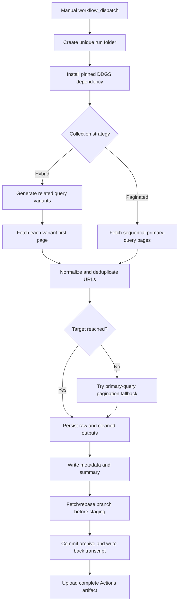

# Architecture

## High-level flow

## Components

- `src/search_collector.py`: query expansion, DDGS request wrapper, response-status capture, both collection strategies, URL normalization, deduplication, exports, and summary.
- `.github/workflows/duckduckgo-search.yml`: manual-only orchestration, run folder creation, dependency setup, metadata, repository write-back, and artifact upload.
- `scripts/archive_run.sh`: Git synchronization and archive commit logic. It fetches/rebases before staging the run directory; it never appends Git output to `run.log` while Git is operating on that file.
- `tests/test_search_collector.py`: deterministic provider-mocked regression tests, including HTTP 202 and write-back ordering.

## Collection modes

### Hybrid

- Builds deterministic query variants based on broad intent signals in the primary query.
- Adds optional user-supplied related queries.
- Requests page 1 for each distinct query using the DuckDuckGo backend.
- Deduplicates globally across all variants.
- If below target, requests later pages for the primary query as a fallback.
- A failed variant is recorded and does not discard prior or subsequent successful variants.

### Paginated

- Requests sequential pages for one query.
- A short page is not considered exhaustion.
- Empty pages, repeated pages, duplicate-only streaks, target completion, page cap, or request failures stop pagination.
- Later-page failures preserve previously collected results.

## Provider status handling

DDGS may log a response URL and HTTP status before raising a generic exception. A temporary logging handler captures status codes. HTTP 202 is classified as `http_202_challenge_or_throttle`; it is not converted to an empty result list. The request receives one cooldown retry, then the error is recorded. The workflow continues with other query variants where possible.

The status classification is diagnostic, not a claim about the provider's exact internal reason. The code does not solve challenges, rotate identities, or bypass rate limits.

## Deduplication and provenance

URLs are normalized by lowercasing scheme/host and removing fragments. Query strings and paths are retained. The flattened raw record includes `_source_query` and `_source_page` metadata; original result dictionaries remain in each page's `results` array. Cleaned records expose `source_query` so a result can be traced to the variant that found it.

## Git write-back

1. Workflow concurrency serializes runs on the same branch.
2. The script fetches the remote branch and rebases before staging any run files.
3. It commits the run folder and pushes with bounded fetch/rebase retries.
4. It writes a separate `repository_writeback.log` and commits that file separately.
5. The Actions artifact is uploaded even when collection or write-back fails.

The write-back transcript is written to a temporary runner file during Git operations. This avoids the previous failure where `tee -a run.log` modified a file after it had been committed and before `git pull --rebase`.
