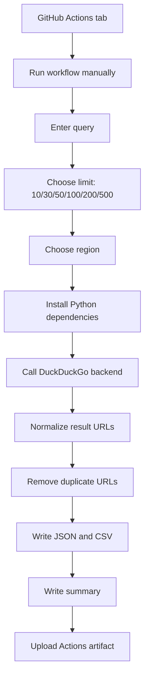

# Architecture and workflow design

## 1. Objective

Phase 1 establishes a reproducible collection layer: a person manually submits
one search query to a GitHub Actions workflow, chooses a result-count ceiling,
and receives structured DuckDuckGo search-result metadata.

## 2. End-to-end flow

## 3. Components

| Component | Responsibility |
|---|---|
| `workflow_dispatch` inputs | Collect runtime query, result limit, and region |
| `setup-python` | Select a reproducible Python runtime |
| `requirements.txt` | Install the DDGS client |
| `src/search_collector.py` | Search, normalize, deduplicate, and export |
| `tests/` | Test transformations and exports without network access |
| `upload-artifact` | Preserve downloadable output files for 30 days |

## 4. Execution contract

- Trigger: manual dispatch only.
- Search backend: explicitly requested DuckDuckGo backend.
- Input result limit: one of 10, 30, 50, 100, 200, or 500.
- Output: JSON, CSV, and text summary.
- Failure behaviour: non-zero process exit on provider failure; empty output
  files and a failure summary are written where possible, then uploaded by the
  workflow's `if: always()` artifact step.

## 5. Why search and crawling are separate

Search results generally contain a title, URL, and short snippet. They are not
the complete content of the linked pages. Keeping page crawling out of Phase 1
makes it easier to test the search layer independently and reduces the number
of network, parsing, and legal/robots considerations in the first release.
