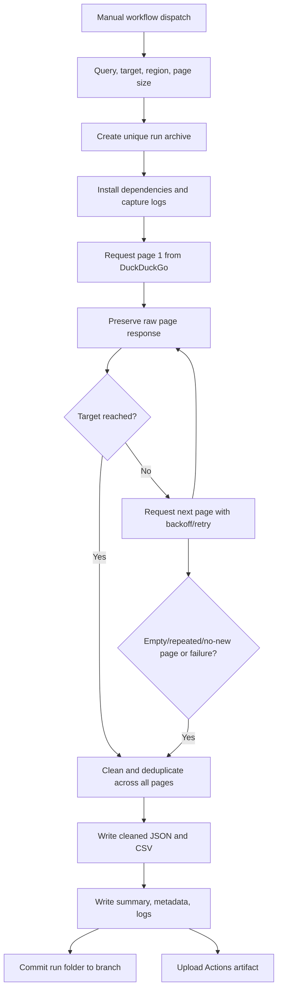

# Architecture

## Pagination-aware collection flow

## Pagination strategy

The DDGS text-search API exposes `page` and `max_results`; the collector makes
sequential page calls with a configurable batch size. It does not assume that
the provider will expose an unlimited number of results.

Stop conditions:
- Requested unique URL target reached.
- Empty page.
- Short page (fewer results than requested batch size).
- Provider repeats an earlier page fingerprint.
- Two consecutive pages contribute no new valid URLs.
- Later page fails after retries (preserve partial data).
- Calculated safety page cap reached.

Transient errors are retried with exponential backoff. Requests are sequential
and separated by a delay to reduce request pressure.

## Raw versus cleaned data

`raw_results.json` is a JSON object containing request parameters, page-level
metadata, each page's original DDGS result dictionaries, and a flattened raw
result list. This preserves the client-returned raw data before normalization.
It is not a packet-level HTTP capture.

`cleaned_results.json` and `cleaned_results.csv` are derived from the flattened
raw list. URLs are restricted to HTTP(S), scheme and host are lowercased,
fragments are removed, and duplicates are removed across all pages. The first
occurrence is retained and ranks are reassigned sequentially.

## Logging and repository write-back

`run.log` captures environment/dependency/search shell output.
`collector.log` captures page-level application events and exceptions.
`metadata.json` stores GitHub run provenance. Each run folder is committed to
the dispatched branch and uploaded as an artifact.
